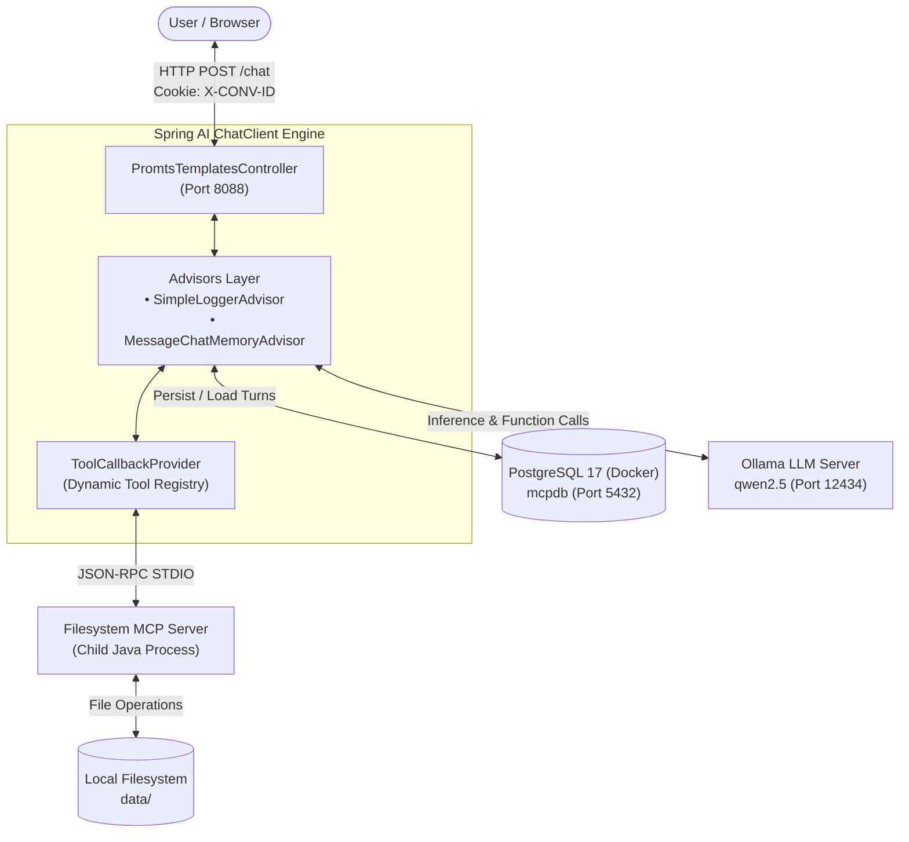

# Filesystem MCP Client

An intelligent, full-stack **Model Context Protocol (MCP)** client built with **Spring Boot 4.1.1**, **Spring AI 2.0.1**, and local LLMs via **Ollama**. The application dynamically discovers and executes filesystem tools exposed by an MCP server over standard input/output (STDIO), manages conversational memory persisted in **PostgreSQL**, and provides an interactive web chat interface.

---

## Table of Contents

- [Overview](#overview)
- [Architecture & Workflow](#architecture--workflow)
- [Key Features](#key-features)
- [Tech Stack](#tech-stack)
- [Project Structure](#project-structure)
- [Configuration](#configuration)
- [Prerequisites & Setup](#prerequisites--setup)
  - [1. Ollama Setup](#1-ollama-setup)
  - [2. Database (Docker Compose)](#2-database-docker-compose)
  - [3. MCP Server Dependency](#3-mcp-server-dependency)
  - [4. Client Configuration](#4-client-configuration)
  - [5. Run the Application](#5-run-the-application)
- [REST API Reference](#rest-api-reference)
- [Web Chat Interface](#web-chat-interface)
- [Prompt Catalog & Scenarios](#prompt-catalog--scenarios)
- [Troubleshooting](#troubleshooting)
- [License](#license)

---

## Overview

The **Filesystem MCP Client** bridges generative AI models and local environment operations using Anthropic's **Model Context Protocol (MCP)** specification. Instead of granting models unconstrained shell access or relying on hardcoded functions, the client connects to an external MCP server process (e.g., [filesystem-mcp-server](file:///Users/rajesh/IdeaProjects/filesystem-mcp-server/target/filesystem-mcp-server-1.0.0-SNAPSHOT.jar)), auto-registers available tools into the Spring AI [ChatClient](file:///Users/rajesh/IdeaProjects/filesystem-mcp-client/src/main/java/com/mcp/client/PromtsTemplatesController.java), and delegates file and data operations safely.

### Why this architecture?
- **Zero Hallucination Operations**: Strict system prompt constraints enforce real tool execution (`read_file`, `write_file`, `create_file`, etc.) before answering.
- **Privacy & Local Execution**: Runs entirely on your local machine using Ollama (`qwen2.5`) with no external data transmission.
- **Stateful Multi-Turn Context**: Preserves conversation history across turns using PostgreSQL JDBC-backed chat memory parameterized by session cookies (`X-CONV-ID`).

---

## Architecture & Workflow



1. **User Request**: User sends a prompt via the Web Chat UI or REST endpoint `POST /chat`.
2. **Session Resolution**: [PromtsTemplatesController](file:///Users/rajesh/IdeaProjects/filesystem-mcp-client/src/main/java/com/mcp/client/PromtsTemplatesController.java) reads or generates a UUID session ID stored in the `X-CONV-ID` cookie.
3. **Memory Retrieval**: `MessageChatMemoryAdvisor` fetches prior turns for that session from PostgreSQL.
4. **Tool Registration**: Spring AI queries the MCP server defined in [mcp.json](file:///Users/rajesh/IdeaProjects/filesystem-mcp-client/src/main/resources/mcp.json) via STDIO and exposes tools to the model.
5. **Model Reasoning & Execution**: Ollama determines whether tool calls are required, requests execution, receives tool outputs from the MCP server, and synthesizes the final response.
6. **Persistence & Return**: The updated dialogue is written to PostgreSQL, and the assistant's response is returned to the user.

---

## Key Features

- **Spring AI MCP Client Integration**: Uses `spring-ai-starter-mcp-client` to automatically discover and invoke tools from external MCP server manifests via STDIO.
- **Local LLM with Ollama**: Integrates seamlessly with Ollama (`http://localhost:12434`) running `qwen2.5:0.5B-F16` or `qwen2.5:1.5b` with zero temperature for deterministic function calling.
- **JDBC Chat Memory**: Multi-turn conversation persistence powered by `spring-ai-starter-model-chat-memory-repository-jdbc` and PostgreSQL.
- **Session Tracking via Cookies**: Automatically manages 1-hour conversation cookies (`X-CONV-ID`), supporting conversation switches and resets.
- **Interactive Web Chat UI**: Built with Bootstrap 5.3.8, Thymeleaf, and custom styling ([styles.css](file:///Users/rajesh/IdeaProjects/filesystem-mcp-client/src/main/resources/static/styles.css)), featuring message bubbles, auto-resizing input, and a "New Chat" session reset trigger.
- **Automated Docker Compose**: Integrated Docker Compose support ([compose.yml](file:///Users/rajesh/IdeaProjects/filesystem-mcp-client/compose.yml)) for PostgreSQL 17 Alpine container.
- **Native Apple Silicon Support**: Bundles `netty-resolver-dns-native-macos:osx-aarch_64` for optimal DNS resolution on macOS.

---

## Tech Stack

| Component | Technology | Version | Description |
|-----------|------------|---------|-------------|
| **Language** | Java | 25 | Modern Java with record classes and virtual thread support |
| **Framework** | Spring Boot | 4.1.1 | Application framework and autoconfiguration |
| **AI Framework** | Spring AI | 2.0.1 | Chat client, advisors, Ollama starter, MCP client |
| **LLM Provider** | Ollama | Latest | Local model runner (`qwen2.5:0.5B-F16`) |
| **Protocol** | Model Context Protocol (MCP) | 2024-11-05 / STDIO | Process-based tool integration |
| **Database** | PostgreSQL | 17-alpine | Durable chat memory storage |
| **Frontend** | Thymeleaf + HTML5 / Bootstrap | 5.3.8 | Clean, responsive web chatbot UI |
| **Build Tool** | Apache Maven | 3.9+ | Dependency and build management |

---

## Project Structure

```
filesystem-mcp-client/
├── compose.yml                               # Docker Compose configuration for PostgreSQL 17
├── pom.xml                                   # Maven dependencies & build plugins
├── readMe.md                                 # Project documentation
├── data/                                     # Sample test files for MCP tools
│   ├── customers.json                        # Structured customer dataset for import/query tasks
│   └── input.txt                             # Text file for summarization and backup tasks
├── logs/                                     # Runtime logs
│   └── files-postgre-mcp.log                 # Server/client execution logs
└── src/
    └── main/
        ├── java/com/mcp/client/
        │   ├── MainFilesSystemMcp.java       # Spring Boot main application entry point
        │   └── PromtsTemplatesController.java# REST controller (/chat) & ChatClient advisor setup
        └── resources/
            ├── application.properties        # Application ports, Ollama settings, JDBC memory
            ├── application.yml               # Spring AI MCP stdio manifest configuration
            ├── mcp.json                      # MCP server process declaration (command & args)
            ├── prompts/
            │   ├── system-message.st         # System prompt with strict MCP tool call rules
            │   └── user-message-1.st         # Sample parameterized StringTemplate prompt
            ├── static/
            │   ├── robot.svg                 # Chatbot avatar graphic
            │   └── styles.css                # Custom chat UI stylesheet
            └── templates/
                └── index.html                # Responsive web chat interface
```

---

## Configuration

### 1. [application.properties](file:///Users/rajesh/IdeaProjects/filesystem-mcp-client/src/main/resources/application.properties)

```properties
spring.application.name=filesystem-mcp-client
server.port=8088

# Ollama LLM Configuration
spring.ai.ollama.base-url=http://localhost:12434
spring.ai.ollama.chat.options.model=qwen2.5:0.5B-F16
spring.ai.ollama.chat.options.temperature=0

# Chat Memory in PostgreSQL
spring.ai.chat.memory.repository.jdbc.initialize-schema=always
logging.level.org.springframework.ai.chat.client.advisor=debug

# MCP Server Manifest Location
spring.ai.mcp.client.stdio.server-configuration=classpath:mcp.json
```

### 2. [mcp.json](file:///Users/rajesh/IdeaProjects/filesystem-mcp-client/src/main/resources/mcp.json)

Defines the MCP server process that the client will launch via STDIO:

```json
{
  "mcpServers": {
    "file-system-mcp": {
      "command": "java",
      "args": [
        "-jar",
        "/Users/rajesh/IdeaProjects/filesystem-mcp-server/target/filesystem-mcp-server-1.0.0-SNAPSHOT.jar",
        "--spring.profiles.active=stdio"
      ]
    }
  }
}
```

> [!IMPORTANT]
> Ensure the jar path in [src/main/resources/mcp.json](file:///Users/rajesh/IdeaProjects/filesystem-mcp-client/src/main/resources/mcp.json) points to the actual compiled jar of your `filesystem-mcp-server`.

### 3. [compose.yml](file:///Users/rajesh/IdeaProjects/filesystem-mcp-client/compose.yml)

```yaml
services:
  postgres:
    image: postgres:17-alpine
    environment:
      - POSTGRES_USER=postgres
      - POSTGRES_PASSWORD=postgres
      - POSTGRES_DB=mcpdb
    ports:
      - "5432:5432"
```

---

## Prerequisites & Setup

### 1. Ollama Setup

Install [Ollama](https://ollama.ai/) and pull the desired model:

```bash
# Pull and verify the Qwen 2.5 model
ollama run qwen2.5:0.5B-F16
# (or)
ollama run qwen2.5:1.5b
```

Verify Ollama is reachable:
```bash
curl http://localhost:12434/api/tags
```

### 2. Database (Docker Compose)

Spring Boot's `spring-boot-docker-compose` module can automatically start the PostgreSQL container. Alternatively, start it manually:

```bash
docker compose up -d
```

Verify PostgreSQL is running:
```bash
docker compose ps
```

### 3. MCP Server Dependency

Ensure the companion server project `filesystem-mcp-server` has been packaged:

```bash
cd /Users/rajesh/IdeaProjects/filesystem-mcp-server
mvn clean package -DskipTests
```

Verify the target jar exists:
```bash
ls -l /Users/rajesh/IdeaProjects/filesystem-mcp-server/target/filesystem-mcp-server-1.0.0-SNAPSHOT.jar
```

### 4. Client Configuration

If your filesystem MCP server jar is located at a different path, update [src/main/resources/mcp.json](file:///Users/rajesh/IdeaProjects/filesystem-mcp-client/src/main/resources/mcp.json) with the correct absolute path.

### 5. Run the Application

Compile and launch the Spring Boot client:

```bash
mvn spring-boot:run
```

Once started, the application will be active at:
- **Web Chat UI**: [http://localhost:8088](http://localhost:8088)
- **Chat Endpoint**: `POST http://localhost:8088/chat`

---

## REST API Reference

### `POST /chat`

Sends a message to the AI assistant with MCP tools and conversational memory.

#### Headers
| Header | Type | Description |
|--------|------|-------------|
| `Content-Type` | `application/json` | Required |
| `Cookie` | `X-CONV-ID=<uuid>` | Optional. Omit to create a new session. |

#### Request Body
```json
{
  "prompt": "Read the file /Users/rajesh/IdeaProjects/filesystem-mcp-client/data/input.txt and summarize it."
}
```

#### Response
```json
{
  "content": "The document discusses Java and Model Context Protocol (MCP) technology..."
}
```
**Response Headers**:
- `Set-Cookie: X-CONV-ID=3d8a56b2-6047-4952-b91c-1e24749f50e7; Path=/; Max-Age=3600`

#### Example `curl` Call

```bash
# First interaction (creates conversation session)
curl -i -X POST http://localhost:8088/chat \
  -H "Content-Type: application/json" \
  -d '{"prompt": "List the files in /Users/rajesh/IdeaProjects/filesystem-mcp-client/data/"}'

# Subsequent interaction using the session cookie
curl -i -X POST http://localhost:8088/chat \
  -H "Content-Type: application/json" \
  -b "X-CONV-ID=3d8a56b2-6047-4952-b91c-1e24749f50e7" \
  -d '{"prompt": "Now summarize the first file you listed."}'
```

---

## Web Chat Interface

The client includes an intuitive web interface located at [src/main/resources/templates/index.html](file:///Users/rajesh/IdeaProjects/filesystem-mcp-client/src/main/resources/templates/index.html):

- **Interactive Messaging**: Send messages via the send button or pressing `Enter` (`Shift + Enter` creates a newline).
- **Session Management**: Conversations persist within the session cookie (`X-CONV-ID`). Clicking **New Chat** resets the cookie and starts a clean conversation thread.
- **Real-Time Tool Execution Feedback**: The bot executes filesystem actions behind the scenes and returns clear confirmations.

---

## Prompt Catalog & Scenarios

Use these battle-tested prompts to test the MCP tool execution pipeline:

### 1. Read a File and Save a Summary
```text
Read the file /Users/rajesh/IdeaProjects/filesystem-mcp-client/data/input.txt. Summarize its contents in clear, concise language. Save the summary to /Users/rajesh/IdeaProjects/filesystem-mcp-client/data/summary.txt using the available filesystem MCP tools. Verify that the file was saved successfully by reading it back. Do not overwrite an existing file without my approval.
```
- **Tools Invoked**: `read_file` ➔ LLM summarization ➔ `create_file` / `write_file` ➔ `read_file`.

### 2. Copy a File / Create a Backup
```text
Copy /Users/rajesh/IdeaProjects/filesystem-mcp-client/data/input.txt to /Users/rajesh/IdeaProjects/filesystem-mcp-client/data/backup.txt in the same directory. Use the available filesystem MCP tools and verify that the copied file exists.
```
- **Tools Invoked**: `read_file` ➔ `create_file` ➔ `get_file_info`.

### 3. Read JSON and Import Data to PostgreSQL
```text
Read /Users/rajesh/IdeaProjects/filesystem-mcp-client/data/customers.json, validate the records, identify the matching PostgreSQL table, and propose an import plan. After my approval, insert valid records using the available PostgreSQL MCP tools and report the inserted row count.
```
- **Tools Invoked**: `read_file` ➔ JSON validation ➔ Database schema validation and import plan.

### 4. Query PostgreSQL and Generate a Markdown Report
```text
Query PostgreSQL for customer counts by city. Format the results as a Markdown report and save it to customer-report.md in my configured filesystem directory. Read the saved file back to verify its contents.
```
- **Tools Invoked**: Database query ➔ Markdown formatting ➔ `create_file` ➔ `read_file`.

---

## Troubleshooting

### 1. Port 8088 Already in Use
Change the port in [application.properties](file:///Users/rajesh/IdeaProjects/filesystem-mcp-client/src/main/resources/application.properties):
```properties
server.port=8089
```

### 2. Ollama Connection Refused
Ensure the Ollama daemon is running locally:
```bash
ollama serve
# Verify port:
curl http://localhost:12434
```

### 3. MCP Server Process Fails to Start
- Check if Java 21+ is available on your shell's default `PATH`.
- Verify the path to the jar in [src/main/resources/mcp.json](file:///Users/rajesh/IdeaProjects/filesystem-mcp-client/src/main/resources/mcp.json).
- Inspect `logs/files-postgre-mcp.log` for any child process startup warnings or missing dependencies.

### 4. PostgreSQL Connection Issues
If chat memory fails to initialize:
- Check container status: `docker compose ps`
- Confirm port `5432` is not occupied by another local Postgres service.
- Check credentials match [compose.yml](file:///Users/rajesh/IdeaProjects/filesystem-mcp-client/compose.yml) (`postgres` / `postgres`, db `mcpdb`).

---

## License

This project is licensed under the Apache License 2.0.